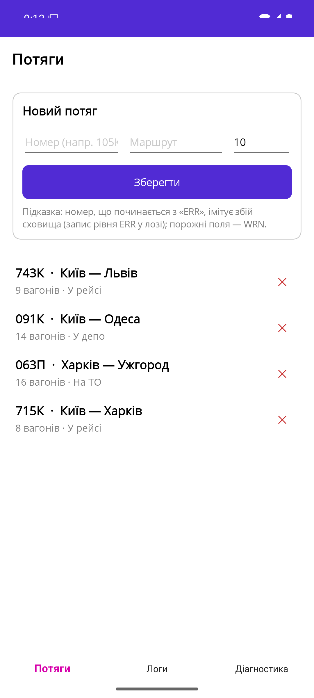
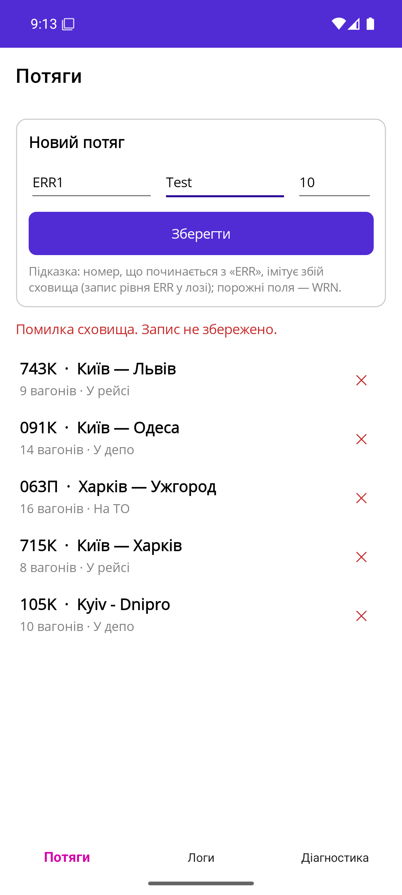
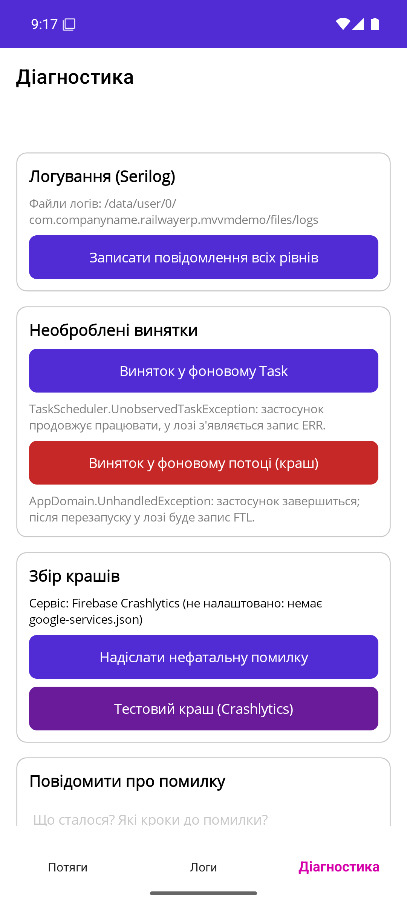
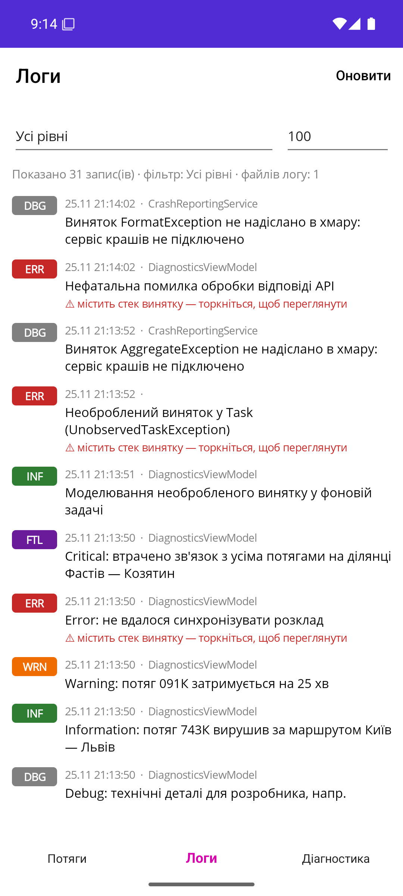
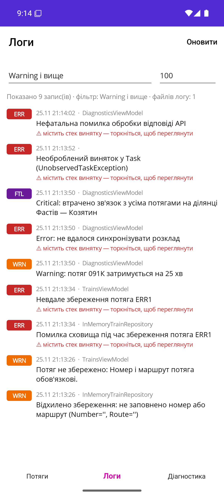
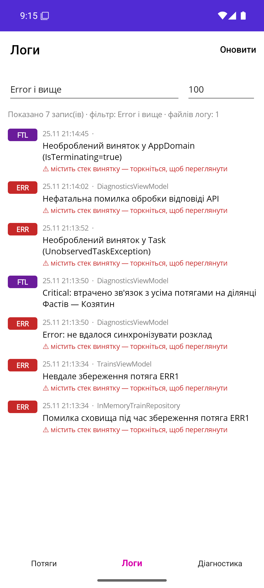
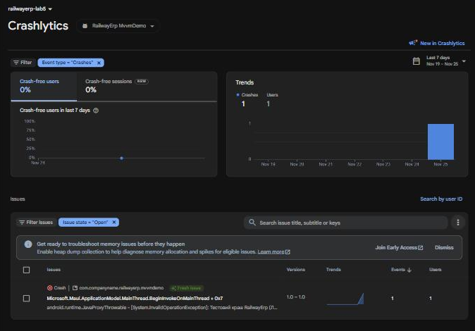
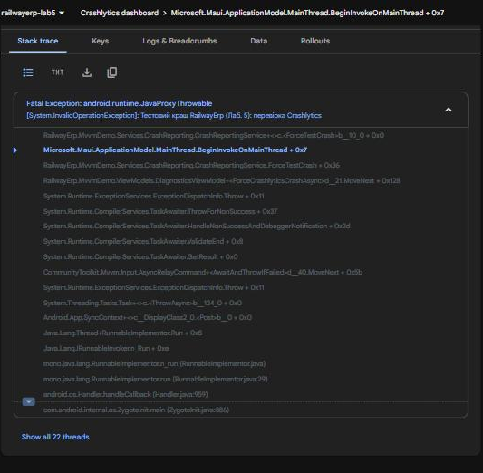

# Звіт до лабораторної роботи №5
## Логування, обробка помилок та аналітика

**Дисципліна:** Мобільна розробка (.NET MAUI, C#, MVVM)
**Проєкт:** RailwayErp.MvvmDemo
**Виконав(ла):** Свириденко Ілля, група ФІТ 2-4

---

## 1. Посилання на репозиторій

_Вставте посилання на гілку `lab5`:_ `https://github.com/<user>/<repo>/tree/lab5`

## 2. Що зроблено

**Аудиторна робота**
1. Serilog підключено як провайдер `ILogger<T>` (`builder.Logging.AddSerilog`). Sink'и: `Console`, `Debug` і `File` з щоденною ротацією (`RollingInterval.Day`), лімітом 7 файлів (`retainedFileCountLimit: 7`) і 5 МБ на файл. У Debug-збірці мінімальний рівень `Debug`, у Release — `Warning`.
2. Логування ключових подій:
   - `InMemoryTrainRepository`: `Debug` — запит до сховища; `Information` — успішне завантаження / збереження / видалення; `Warning` — невалідні дані, дублікат номера; `Error` — збій сховища (номер, що починається з `ERR`).
   - `TrainsViewModel`: `Information` — початок і кінець завантаження з тривалістю; `Warning` — помилка вводу; `Error` — технічний збій зі стеком.
3. Глобальні обробники (`GlobalExceptionHandler`): `AppDomain.CurrentDomain.UnhandledException` → `Fatal` + `Log.CloseAndFlush()`; `TaskScheduler.UnobservedTaskException` → `Error` + `SetObserved()`; на Android додатково `AndroidEnvironment.UnhandledExceptionRaiser`.
4. Моделювання: кнопка «Виняток у фоновому Task» запускає `Task.Run(() => throw …)` без `await` і примусово викликає `GC.Collect()`, тож подія `UnobservedTaskException` спрацьовує одразу. Кнопка «Виняток у фоновому потоці» кидає виняток у `new Thread(...)` → `AppDomain.UnhandledException`, запис `FTL`, застосунок завершується.

**Самостійна робота**

5. Firebase Crashlytics (`Plugin.Firebase.Crashlytics`) за інтерфейсом `ICrashReportingService`. Кнопки «Тестовий краш» (фатальний) і «Надіслати нефатальну помилку» (`RecordException`).
6. Екран «Логи»: останні N (50/100/200/500) записів із файлів журналу, фільтр за мінімальним рівнем, кольоровий бейдж рівня, перегляд стека винятку по торканню. Файл читається з `FileShare.ReadWrite`, бо Serilog тримає його відкритим.

Додатково (п. 1.6): кнопка «Повідомити про помилку» формує звіт (опис користувача + версія застосунку, модель і ОС пристрою + останні 80 рядків логу) і відкриває системне меню «Поділитися».

## 3. Фрагмент лог-файлу

Фрагмент реального файлу `files/logs/app-20261125.log`, знятого з емулятора Android 15 (Pixel 6) через
`adb shell run-as com.companyname.railwayerp.mvvmdemo cat files/logs/app-20261125.log`.
Повний файл: [`app-20261125.log`](app-20261125.log).

Видно всі рівні: `DBG`, `INF`, `WRN`, `ERR`, `FTL`. `[ERR] : Необроблений виняток у Task` записав глобальний обробник
`TaskScheduler.UnobservedTaskException` (п. 2.1.4), а `[FTL] : Необроблений виняток у AppDomain` — `AppDomain.UnhandledException`
безпосередньо перед аварійним завершенням застосунку. Після нього в лозі видно повторний запуск.

```
2026-11-25 21:12:53.464 +02:00 [INF] : Глобальні обробники необроблених винятків зареєстровано
2026-11-25 21:12:53.612 +02:00 [INF] : Запуск RailwayErp 1.0 на Android 15
2026-11-25 21:12:54.998 +02:00 [INF] RailwayErp.MvvmDemo.ViewModels.TrainsViewModel: Завантаження списку потягів розпочато
2026-11-25 21:12:55.003 +02:00 [DBG] RailwayErp.MvvmDemo.Repositories.InMemoryTrainRepository: Запит списку потягів до сховища
2026-11-25 21:12:56.001 +02:00 [INF] RailwayErp.MvvmDemo.Repositories.InMemoryTrainRepository: Зі сховища завантажено 4 потягів
2026-11-25 21:12:56.022 +02:00 [INF] RailwayErp.MvvmDemo.ViewModels.TrainsViewModel: Список потягів завантажено: 4 шт. за 1024 мс
2026-11-25 21:13:25.114 +02:00 [INF] RailwayErp.MvvmDemo.Repositories.InMemoryTrainRepository: Додано потяг 105K (Id=5), маршрут Kyiv - Dnipro
2026-11-25 21:13:25.121 +02:00 [INF] RailwayErp.MvvmDemo.ViewModels.TrainsViewModel: Потяг 105K успішно збережено (Id=5)
2026-11-25 21:13:26.855 +02:00 [WRN] RailwayErp.MvvmDemo.Repositories.InMemoryTrainRepository: Відхилено збереження: не заповнено номер або маршрут (Number='', Route='')
2026-11-25 21:13:26.858 +02:00 [WRN] RailwayErp.MvvmDemo.ViewModels.TrainsViewModel: Потяг не збережено: Номер і маршрут потяга обов'язкові.
2026-11-25 21:13:34.716 +02:00 [ERR] RailwayErp.MvvmDemo.Repositories.InMemoryTrainRepository: Помилка сховища під час збереження потяга ERR1
System.IO.IOException: Сховище недоступне: таймаут запису (імітація).
2026-11-25 21:13:34.723 +02:00 [ERR] RailwayErp.MvvmDemo.ViewModels.TrainsViewModel: Невдале збереження потяга ERR1
System.IO.IOException: Сховище недоступне: таймаут запису (імітація).
   at RailwayErp.MvvmDemo.Repositories.InMemoryTrainRepository.SaveAsync(Train train, CancellationToken ct)
   at RailwayErp.MvvmDemo.ViewModels.TrainsViewModel.AddTrainAsync()
2026-11-25 21:13:50.051 +02:00 [DBG] RailwayErp.MvvmDemo.ViewModels.DiagnosticsViewModel: Debug: технічні деталі для розробника, напр. параметри запиту
2026-11-25 21:13:50.052 +02:00 [INF] RailwayErp.MvvmDemo.ViewModels.DiagnosticsViewModel: Information: потяг 743К вирушив за маршрутом Київ — Львів
2026-11-25 21:13:50.052 +02:00 [WRN] RailwayErp.MvvmDemo.ViewModels.DiagnosticsViewModel: Warning: потяг 091К затримується на 25 хв
2026-11-25 21:13:50.053 +02:00 [ERR] RailwayErp.MvvmDemo.ViewModels.DiagnosticsViewModel: Error: не вдалося синхронізувати розклад
System.TimeoutException: Сервер диспетчерської не відповідає
2026-11-25 21:13:50.053 +02:00 [FTL] RailwayErp.MvvmDemo.ViewModels.DiagnosticsViewModel: Critical: втрачено зв'язок з усіма потягами на ділянці Фастів — Козятин
2026-11-25 21:13:51.633 +02:00 [INF] RailwayErp.MvvmDemo.ViewModels.DiagnosticsViewModel: Моделювання необробленого винятку у фоновій задачі
2026-11-25 21:13:52.172 +02:00 [ERR] : Необроблений виняток у Task (UnobservedTaskException)
System.AggregateException: A Task's exception(s) were not observed either by Waiting on the Task or accessing its Exception property. As a result, the unobserved exception was rethrown by the finalizer thread. (Збій фонової синхронізації розкладу (змодельований необроблений виняток у Task))
 ---> System.InvalidOperationException: Збій фонової синхронізації розкладу (змодельований необроблений виняток у Task)
   at RailwayErp.MvvmDemo.ViewModels.DiagnosticsViewModel.<>c.<StartFireAndForget>b__19_0()
   ...
   --- End of inner exception stack trace ---
2026-11-25 21:14:02.416 +02:00 [ERR] RailwayErp.MvvmDemo.ViewModels.DiagnosticsViewModel: Нефатальна помилка обробки відповіді API
System.FormatException: Некоректний формат відповіді API квитків (змодельовано)
   at RailwayErp.MvvmDemo.ViewModels.DiagnosticsViewModel.RecordNonFatal()
2026-11-25 21:14:45.182 +02:00 [WRN] RailwayErp.MvvmDemo.ViewModels.DiagnosticsViewModel: Моделювання необробленого винятку у фоновому потоці (застосунок завершиться)
2026-11-25 21:14:45.188 +02:00 [FTL] : Необроблений виняток у AppDomain (IsTerminating=true)
System.ApplicationException: Критичний збій потоку телеметрії потягів (змодельований)
   at RailwayErp.MvvmDemo.ViewModels.DiagnosticsViewModel.<>c.<SimulateBackgroundThreadCrashAsync>b__20_0()
   at System.Threading.Thread.StartHelper.RunWorker()
2026-11-25 21:15:08.484 +02:00 [INF] : Глобальні обробники необроблених винятків зареєстровано
2026-11-25 21:15:08.599 +02:00 [INF] : Запуск RailwayErp 1.0 на Android 15
```

## 4. Скріншоти

Знято на емуляторі Android 15 (Pixel 6, API 35).

| Екран | Файл |
|---|---|
| Список потягів |  |
| Помилка сховища при збереженні (запис ERR) |  |
| Діагностика: моделювання винятків і збір крашів |  |
| **Екран перегляду логів**: усі рівні |  |
| **Екран перегляду логів**: фільтр «Warning і вище» |  |
| **Екран перегляду логів** після аварійного завершення: фільтр «Error і вище», зверху запис `FTL` з `AppDomain.UnhandledException` |  |
| **Панель Firebase Crashlytics** (проєкт `railwayerp-lab5`): issue «Тестовий краш RailwayErp (Лаб. 5)», 1 подія, 1 користувач |  |
| **Звіт про краш у Crashlytics**: `Fatal Exception` зі стеком C#-методів (`CrashReportingService.ForceTestCrash` → `DiagnosticsViewModel.ForceCrashlyticsCrashAsync`), Android 15, модель `sdk_gphone64_x86_64`, версія 1.0 (1) |  |

Перевірка Crashlytics (п. 2.2.5): після натискання «Тестовий краш (Crashlytics)» SDK записав у logcat
`Crashlytics report successfully enqueued to DataTransport`, і за ~1 хв звіт з'явився в Firebase Console → Crashlytics.

---

## 5. Відповіді на контрольні питання

### 7. Які рівні логування визначені в .NET і коли доцільно використовувати кожен з них?

`Microsoft.Extensions.Logging.LogLevel` визначає шість рівнів (плюс `None` — вимкнути):

| Рівень | Коли використовувати | Приклад у проєкті |
|---|---|---|
| **Trace** | Найдетальніша інформація: покрокове виконання, значення змінних. Лише під час налагодження, у продакшні вимкнено. | — |
| **Debug** | Технічні деталі для розробника: параметри запитів, проміжні стани. Корисно в Debug-збірці. | «Запит списку потягів до сховища» |
| **Information** | Нормальний перебіг роботи, ключові бізнес-події. | «Додано потяг 743К» |
| **Warning** | Нештатна, але оброблена ситуація; застосунок працює далі. Невалідний ввід, повторна спроба, деградація. | «Відхилено збереження: потяг уже існує» |
| **Error** | Операція не вдалася через помилку, але застосунок працює далі. Логується разом із винятком. | «Помилка сховища під час збереження» |
| **Critical** | Збій, після якого застосунок не може працювати (Serilog називає його `Fatal`). | «Необроблений виняток у AppDomain» |

У продакшн-збірці зазвичай залишають `Warning` і вище, щоб не засмічувати журнал і не втрачати продуктивність. У Debug-збірці — `Debug` або `Trace`.

### 8. Чим Serilog відрізняється від стандартного ILogger і навіщо потрібні sink'и?

`ILogger<T>` — це **абстракція** (інтерфейс) з `Microsoft.Extensions.Logging`: код пише в неї, не знаючи, куди підуть повідомлення. Вбудовані провайдери прості (Debug, Console, EventLog) і не вміють, наприклад, писати у файл із ротацією.

**Serilog** — повноцінна бібліотека **структурованого** логування, яка підключається як провайдер `ILogger`:
- зберігає не лише текст, а й **властивості подій** (`{Number}`, `{Count}`), які можна фільтрувати й шукати;
- має гнучку конфігурацію: мінімальні рівні для окремих просторів імен (`MinimumLevel.Override`), збагачувачі (`Enrich.WithProperty`), шаблони виводу;
- має велику екосистему **sink'ів**.

**Sink** (приймач) — це місце, куди Serilog записує події: консоль, файл, Seq, Elasticsearch, Application Insights тощо. Можна підключити кілька sink'ів одночасно, кожен зі своїм форматом і рівнем. Наприклад, консоль для розробника під час налагодження і файл із ротацією для діагностики на пристрої.

### 9. Чому необроблені винятки у фонових Task можуть залишитися непоміченими без TaskScheduler.UnobservedTaskException?

Виняток усередині `Task` не «вилітає» назовні одразу: він **зберігається в об'єкті Task** і перекидається лише тоді, коли хтось його «спостерігає» — робить `await`, `.Wait()`, `.Result` або читає `.Exception`. Якщо задачу запустили за принципом fire-and-forget (`_ = Task.Run(...)`), ніхто її не очікує, і виняток ніде не з'являється: немає ні краху, ні повідомлення, а операція тихо не виконалась.

Починаючи з .NET 4.5 такий виняток за замовчуванням **не завершує процес**. Його можна помітити лише через подію `TaskScheduler.UnobservedTaskException`, яка спрацьовує, коли збирач сміття **фіналізує** Task. Саме тому в демо після запуску задачі примусово викликається `GC.Collect()`. Без цього обробника такі помилки фонової синхронізації, відправки даних тощо зникають безслідно.

### 10. У чому різниця між ручним файловим логуванням і сервісом автоматичного збору крашів?

| | Файловий лог (Serilog → файл) | Сервіс крашів (Crashlytics, Sentry, App Center) |
|---|---|---|
| Де дані | Локально на пристрої | У хмарі, доступні розробнику одразу |
| Хто збирає | Розробник явно викликає `_logger.Log…` | Автоматично перехоплює краші, зокрема нативні |
| Доступ | Потрібен фізичний доступ до пристрою або дії користувача | Звіти з усіх пристроїв користувачів |
| Аналітика | Немає | Групування однакових крашів, кількість користувачів, версії, crash-free rate, тренди |
| Що містить | Усе, що ви залогували: хронологію подій | Стек, модель і ОС, стан пам'яті, хлібні крихти, кастомні ключі |
| Коли краш | Якщо застосунок впав миттєво, запис міг не встигнути потрапити у файл | Нативний обробник зберігає звіт і надсилає при наступному запуску |

Ці підходи доповнюють один одного. Лог показує, що відбувалося перед помилкою, а сервіс крашів показує, що вона сталася, у скількох користувачів і де саме в коді.

### 11. Яку інформацію, крім стека викликів, корисно додавати до звіту про помилку?

- **Версія та збірка застосунку** (`AppInfo.VersionString`, `BuildString`): щоб знати, чи вже виправлено.
- **Пристрій і ОС**: платформа, версія ОС, виробник і модель, емулятор чи фізичний пристрій.
- **Останні записи логу** («хлібні крихти»): дії користувача й події перед помилкою.
- **Поточний екран і стан застосунку**: відкрита сторінка, ключові параметри (напр. `RouteId`).
- **Мова й регіональні налаштування**: часто причина помилок форматування дат і чисел.
- **Стан середовища**: мережа (онлайн/офлайн, Wi-Fi/мобільна), вільна пам'ять і місце, рівень заряду.
- **Опис від користувача**: що робив і що очікував.
- **Час події та часовий пояс.**
- **Чи був краш при попередньому запуску** (`DidCrashOnPreviousExecution`).
- **Ідентифікатор сесії або анонімний ID встановлення**: щоб пов'язати кілька звітів, без персональних даних.

У проєкті це реалізує `BugReportService.BuildReportAsync`.

### 12. Які ризики для приватності користувача варто враховувати при зборі аналітики та crash-звітів?

- **Персональні дані в логах і звітах.** Імена, e-mail, телефони, адреси, номери документів чи карток, геолокація, токени й паролі можуть потрапити в повідомлення логу, параметри запитів або текст винятку. Їх треба маскувати або не логувати взагалі.
- **Передача даних третій стороні.** Firebase і App Center — це сервери Google і Microsoft, часто за межами країни користувача. Це має бути зазначено в політиці конфіденційності; для ЄС це вимоги GDPR, в Україні — Закону «Про захист персональних даних».
- **Згода користувача.** Аналітику варто вмикати лише після згоди (opt-in) і давати змогу вимкнути її (`SetCrashlyticsCollectionEnabled(false)`). На iOS для відстеження потрібен запит App Tracking Transparency, а в App Store і Google Play — заповнені декларації про збір даних (Privacy Manifest, Data Safety).
- **Ідентифікація користувача.** `SetUserId` і стабільні ідентифікатори пристрою дозволяють відстежувати конкретну людину. Краще використовувати анонімний випадковий ID встановлення.
- **Мінімізація.** Збирати лише те, що потрібно для діагностики, і обмежувати строк зберігання (у проєкті локальні логи зберігаються 7 днів).
- **Безпека локальних логів.** Файли в `AppDataDirectory` недоступні іншим застосункам, але потрапляють у резервні копії і стають доступні при root/jailbreak. Тому секретів у логах бути не повинно, а в Release-збірці слід знижувати детальність до `Warning`.
- **Ручні звіти.** Користувач має бачити, що саме надсилається (у проєкті звіт відкривається через системне меню «Поділитися», тож користувач сам обирає, кому його надіслати).
